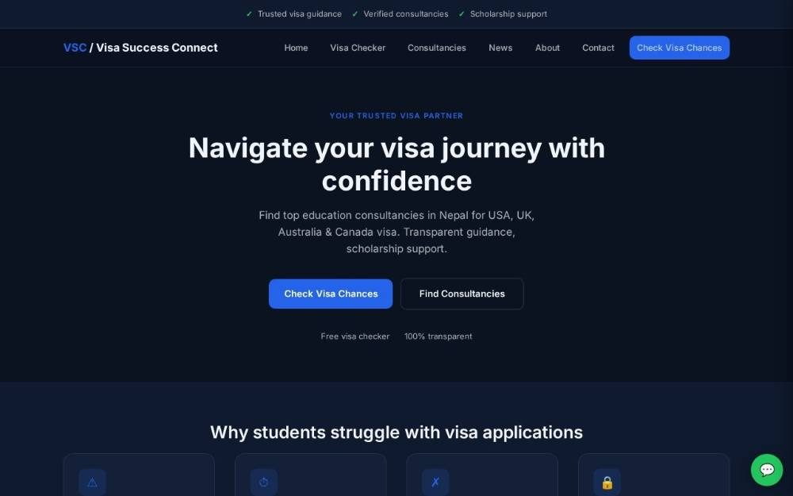

# Visa Success Connect

**Find the right study-abroad consultancy in Nepal.** Visa Success Connect is a recommendation platform that helps students compare education consultancies, check their visa readiness and find scholarships for the USA, UK, Australia and Canada.

**Live site:** [vscplatform.info](http://vscplatform.info)



## Features

- Directory of education consultancies across Nepal, with a profile page for each
- Free visa checker that gives students a results page
- Scholarship support and a visa news blog
- Partner page for consultancies that want to join
- FAQ, contact, privacy and terms pages
- SEO-ready page titles and descriptions on every page

## Tech stack

Static HTML, CSS and vanilla JavaScript (`vsc-ui-static/`), with no build step. Redirects are set in `_redirects`.

## Run locally

Open `vsc-ui-static/index.html` in a browser, or serve the folder:

```bash
npx serve vsc-ui-static
```

## Pages

| Page | File |
|---|---|
| Home | `index.html` |
| Consultancies directory | `consultancies.html` |
| Consultancy profile | `consultancy.html` |
| Visa checker and results | `visa-checker.html`, `result.html` |
| Scholarships | `scholarship.html` |
| Blog and posts | `blog.html`, `blog-post.html` |
| About, FAQ, Contact, Partner | `about.html`, `faq.html`, `contact.html`, `partner.html` |
| Privacy and terms | `privacy.html`, `terms.html` |

---

Built by **Ajit Thapa Magar**, web developer and product manager in Kathmandu. Portfolio: [ajit-portfolio-six.vercel.app](https://ajit-portfolio-six.vercel.app)
